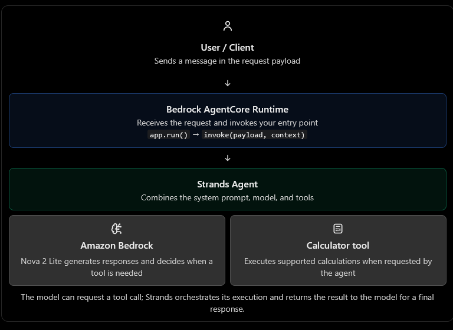

# Introduction to Strands SDK and AgentCore Runtime

## Building the First WanderBot

Horizon Travel is launching WanderBot, an AI travel concierge. In this module you'll build the first version from scratch with the Strands SDK, wrap it in a BedrockAgentCoreApp entrypoint, and ship it to Amazon Bedrock AgentCore Runtime with the built-in calculator tool wired in.

## Learning outcomes

By the end of this module, you will be able to:

- Instantiate a minimal Strands `Agent` backed by a `BedrockModel`.
- Wrap an agent as a deployable service using `BedrockAgentCoreApp` and `@app.entrypoint`.
- Plug a built-in Strands tool (`calculator`) into the agent with a single import.
- Iterate locally with `agentcore dev` and deploy with `agentcore deploy`.

## Install and verify the AgentCore CLI

Before continuing, install `uv` and the AgentCore starter toolkit:

```bash
pip install uv
uv pip install bedrock-agentcore-starter-toolkit
```

Verify that the AgentCore CLI is available:

```bash
agentcore --help
```

## Run and test locally

From this directory, configure the AgentCore project and start the local development server:

```bash
agentcore configure
agentcore dev
```

Leave `agentcore dev` running. In a second terminal, run a local test invocation:

```bash
agentcore invoke --dev '{"message": "A flight costs $349. Hotel is $175/night for 4 nights. Total?"}'
```

## Deploy and verify

Once local tests pass, deploy the application:

```bash
agentcore deploy --auto-update-on-conflict
```

Then verify the deployed application with an invocation:

```bash
agentcore invoke '{"message": "How do I contact Horizon Travel customer support?"}'
```

# Understanding your AWS Bedrock AgentCore application

This code builds a simple AI travel assistant called WanderBot using three main components:

- Amazon Bedrock — provides the foundation model that understands user requests and generates responses.
- Strands Agents SDK — manages the agent's reasoning and tool usage.
- Amazon Bedrock AgentCore Runtime — hosts the application and provides an entry point for incoming requests.

The assistant can answer travel questions and use a calculator tool when it needs to calculate costs, tips, totals, durations, or percentages.

## 1. Understand the architecture first



Think of this as a data pipeline:

- AgentCore Runtime is the ingestion and serving layer.
- Strands is the orchestration layer.
- The foundation model is the reasoning and language-generation layer.
- The calculator is an executable capability the agent can use.

One important distinction: AgentCore Runtime hosts and invokes your application; Strands implements the agent loop. They are not the same component.

## 2. Line-by-line explanation

### A. Import the dependencies

```python
from bedrock_agentcore.runtime import BedrockAgentCoreApp
from strands import Agent 
from strands.models import BedrockModel 
from strands_tools import calculator 
```

| Import                | Responsibility                                                                               |
| --------------------- | -------------------------------------------------------------------------------------------- |
| `BedrockAgentCoreApp` | Provides the AgentCore application wrapper, entry-point registration, and runtime interface. |
| `Agent`               | Creates the Strands agent that coordinates the model and its tools.                          |
| `BedrockModel`        | Configures a foundation model accessed through Amazon Bedrock.                               |
| `calculator`          | Imports a ready-made tool that the agent can invoke for calculations.                        |


### B. Initialize the runtime application

```
app = BedrockAgentCoreApp()
```

This creates the application object that you'll configure with an entry point and eventually run.

It does not create the AI agent itself. That happens later when you instantiate `Agent`.

The distinction matters because the runtime application handles incoming requests, while the agent handles the actual AI task.

### C. Configure the foundation model

```
MODEL_ID = "us.amazon.nova-2-lite-v1:0"model = BedrockModel(model_id=MODEL_ID)
```

Here, you're configuring a model through the Strands Bedrock integration.

- `MODEL_ID` identifies the model you want to use.
- `BedrockModel(...)` creates the model adapter that Strands uses to communicate with Bedrock.
- The model's response generation happens when the agent invokes it, not merely when this object is created.

The model is configured outside the request handler, so the same configuration can be reused across invocations instead of being reconstructed for every incoming message.

Production consideration: Ensure the selected model ID is available in your AWS Region and that the runtime's IAM role has the necessary Bedrock permissions. The `us.` prefix is part of the model identifier; it does not replace IAM authorization or deployment configuration.

### D. Define the system prompt

```
SYSTEM_PROMPT = """You are WanderBot, the AI travel assistant for Horizon Travel.When asked to calculate costs, tips, totals, durations, or percentages,use the calculator tool. Keep answers friendly, concise, travel-focused."""
```

The system prompt defines the agent's role, behavioral rules, and expected response style.

Let's break down the instructions:

| Instruction                              | Effect                                        |
| ---------------------------------------- | --------------------------------------------- |
| `You are WanderBot`                      | Establishes the assistant's identity.         |
| `AI travel assistant for Horizon Travel` | Defines its business context.                 |
| `use the calculator tool`                | Encourages tool usage for mathematical tasks. |
| `friendly, concise, travel-focused`      | Guides the tone and relevance of responses.   |

For example, the user asks:

> I'm booking a hotel for 4 nights at $125 per night. Add a 12% tax. What's my total?

The agent should recognize that this requires calculation rather than relying on mental arithmetic from the model.

It can use the calculator to evaluate:

\\[ (4 \times 125) \times 1.12 = 560 \\]

Then it can respond with a friendly explanation of the $560 total.

Important: A system prompt is an instruction to the model, not a guaranteed enforcement mechanism. For financial or booking operations in production, validate calculations and business rules in application code when correctness is critical.

### E. Register the entry point

```
@app.entrypointasync def invoke(payload: dict, context=None):
```

This is one of the most important parts of the application.

What is an entry point?

An entry point is the function the AgentCore Runtime invokes when a request reaches your application.

Let's examine each part:

- `@app.entrypoint` registers `invoke` as the runtime's request handler.
- `async def` declares an asynchronous Python function.
- `payload: dict` indicates that the handler expects a dictionary containing request data.
- `context=None` allows the handler to receive runtime context when supplied.

For example, a request might contain:

```
{    "message": "Calculate the cost of a $200 hotel room for 3 nights"}
```

The runtime passes the request payload to your handler, and your code decides what to do with it.

The `context` argument is optional in this implementation because the code doesn't use it. In a more advanced application, runtime context can help you access invocation or session-related information, depending on the available runtime interface.

Official reference: [AgentCore Runtime entry-point pattern](https://docs.aws.amazon.com/guidance/latest/agentic-vehicle-experience-on-aws/agentcore-runtime.html?utm_source=chatgpt.com).

### F. Extract the user's message

```
user_message = payload.get("message", "Hello!")
```

This retrieves the value associated with the `message` key.

Python's `dict.get()` accepts two arguments:

```
dictionary.get(key, default_value)
```

It returns the value for the key if it exists; otherwise, it returns the default.

Consider these examples:

| Incoming payload                 | `user_message`      |
| -------------------------------- | ------------------- |
| `{"message": "Hello WanderBot"}` | `"Hello WanderBot"` |
| `{}`                             | `"Hello!"`          |
| `{"message": ""}`                | `""`                |
| `{"message": None}`              | `None`              |

Notice the last two cases. The default applies only when the key is missing, not when the value is empty or `None`.

For production, validate the input before passing it to the agent:

```
user_message = payload.get("message")if not isinstance(user_message, str) or not user_message.strip():    return {"error": "A non-empty message is required."}
```

You should also consider maximum message length and any request schema required by your client.

### G. Construct the Strands agent

```
agent = Agent(    model=model,    system_prompt=SYSTEM_PROMPT,    tools=[calculator],)
```

This creates the actual AI agent.

The `Agent` constructor receives three key dependencies:

`model=model`

The language model used to understand requests and generate responses.

`system_prompt=SYSTEM_PROMPT`

The instructions that establish the agent's role and behavior.

`tools=[calculator]`

The tools available for the model to request during its execution.

The important concept is that giving an agent a tool is not the same as executing that tool.

The tool is made available to the agent. The model decides when to request it based on the conversation and tool description, and Strands manages execution of the requested tool and returns its result to the model.&#x20;


The model uses the available information to formulate its answer.

This loop is a key part of agent engineering: the model can request an action, receive the result, and then continue generating its answer. Strands orchestrates that interaction for you rather than requiring you to implement the entire loop manually.

One technical detail: `agent(user_message)` returns a Strands agent result object, not necessarily a plain Python string. Check the output contract of your deployed runtime and client. If the client expects plain text, you may need to return `str(result)`; if it expects structured JSON, return an appropriate serializable dictionary.

Also, your handler is declared `async`, but the agent call is synchronous in the code shown. That can block the event loop while the model request runs. For a concurrent production service, use the SDK's supported asynchronous invocation pattern if available in your installed version, or otherwise account for the blocking behavior.
